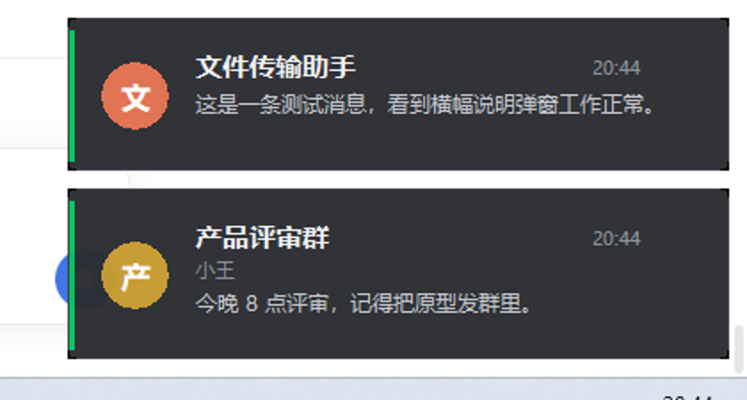

# 微信消息弹窗 · WxPopup

给**电脑版微信**补上 QQ 那样的右下角消息弹窗。

> 微信 PC 端（到 4.1.x）官方只做「任务栏闪烁 + 托盘提示 + 提示音」，没有桌面横幅。
> 这个工具用**只读**方式读微信自己的会话库，收到新消息就在屏幕角落弹一条横幅：
> 显示谁发的、说了什么，能合并计数、能跟随免打扰、能单独放行「特别关注」的群成员。



## 特性

- **右下角横幅**：圆角卡片、滑入淡入、置顶不抢焦点（`WS_EX_NOACTIVATE`），点一下把微信叫到前台
- **跟随微信的免打扰**：微信里设了「消息免打扰」的群自动不弹（读 `contact.chat_room_notify`，并用界面上的「铃铛加斜杠」图标交叉验证过）
- **特别关注成员**：免打扰群里点名的几个人照样弹——微信群成员列表可视化勾选，勾完即生效
- **托盘常驻**：绿底「微」图标，悬停看状态（运行中 / 已暂停 / 等待微信），右键设置、暂停、退出
- **完全只读**：不注入、不挂钩、不修改微信任何文件，不联网
- **单实例 + 开机自启 + 优雅退出**，配置改动热重载
- **客户端形态**：PyInstaller 打包，目标机器不需要 Python

## 原理（为什么这是只读的）

微信 4.x 的聊天数据存在 `xwechat_files\<账号>\db_storage\` 下的 **SQLCipher 4** 数据库里
（AES-256-CBC + HMAC-SHA512，页 4096，页尾 80 字节放 IV 和 MAC）。解密需要每个库自己的 32 字节密钥，
它由微信缓存在自己的进程内存中，形如 `x'<64位hex密钥><32位hex盐>'`，且 4.0.3 之后被一段 32 字节固定掩码异或过。

本工具做的三件事：

1. 用 `ReadProcessMemory` **只读**扫描微信进程内存（只扫 `MEM_PRIVATE` 堆），按掩码反解出候选密钥；
2. 用「页 1 的 HMAC」校验候选——这是唯一权威判据，错一个字节都解不开，不存在猜；
3. 解密 `session.db`（约 740KB，不是几百 MB 的 `message_*.db`）读会话列表：谁、什么时间、最后一句说了什么、有没有未读。

`session.db` 只有几百 KB，所以每秒轮询一次的平均开销是 **~5.6 ms**；`message_*.db` 单个可达几百 MB，完全不碰。

## 使用

### 方式一：直接用客户端（推荐，无需 Python）

**下载**：到 [Releases](https://github.com/shiqi4417-ctrl/WxPopup/releases/latest) 拿 `WxPopup-vX.Y.Z-win64.zip`（约 22 MB，解压后 50 MB）。

1. 解压到**纯英文路径**，例如 `D:\WxPopup`
2. 双击 `WxPopup.exe`。首次启动会花 3~8 秒扫内存取密钥，之后走缓存秒开
3. 详细说明见 [说明.md](说明.md)

> ⚠️ **必须放英文路径**。Tcl/Tk 处理不了中文安装路径，放进 `D:\微信工具\` 这类目录会启动后卡住。
> 中文名只能用在快捷方式上。

### 方式二：源码运行

```bash
pip install cryptography pillow
python main.py            # 正常启动
python main.py --demo     # 演示模式（不需要微信）
python main.py --doctor   # 环境诊断：进程 / 目录 / 密钥 / 解密 / 会话
python main.py --status   # 查是否在运行（进程号、会话数、是否暂停）
python main.py --quit     # 让运行中的实例退出
python main.py --star     # 打开「特别关注成员」选择器
```

打包客户端：双击 `打包.bat`（内部调用 PyInstaller，产物覆盖安装到 `%LOCALAPPDATA%\Programs\WxPopup`）。

## 前提条件

| 必须 | 说明 |
|---|---|
| 微信 PC 版 **4.x**，已登录并运行 | 密钥只在进程内存里；3.x 库结构不同，不支持 |
| Windows 10 / 11 **64 位** | 横幅、托盘、读内存都依赖 Win32 |
| 与微信同权限级别运行 | 微信若「以管理员身份运行」，本程序也必须提权 |

不需要：Python（客户端形态）、联网、管理员（除非微信提权了）、任何驱动。

## 配置

面板上只有常用项（位置 / 主题 / 停留秒数 / 堆叠数 / 宽度 / 刷新间隔 / 开机自启 / 特别关注成员）。
其余开关按舒服的默认值固定，改 `%APPDATA%\微信消息弹窗\config.json` 即可（保存后热重载）：

| 键 | 默认 | 含义 |
|---|---|---|
| `show_content` | `true` | 是否显示消息正文（关掉只显示「你收到了一条新消息」） |
| `only_when_unfocused` | `true` | 微信在前台时不打扰 |
| `follow_wechat_mute` | `true` | 跟随微信的「消息免打扰」 |
| `skip_official` | `true` | 忽略公众号 |
| `sound` | `false` | 额外播一声提示音（微信自己会响） |
| `star_rules` | `[]` | 免打扰群里的放行名单，格式 `群名>成员A,成员B` |

## 已知限制

- 单聊的「消息免打扰」微信存在别处（`chat_room_notify` 对所有单聊恒为 0），目前**只识别群聊**
- 只提醒不回复；点击横幅只把微信叫到前台，**不会**定位到具体会话
- 微信大版本升级若改了加密参数/密钥位置，需要重新提取（删 `keys.json` 重启）
- 多开多个微信账号时只监听一个（自动选密钥校验通过的那个）
- 客户端必须放在英文路径下

## 免责声明

本项目仅用于**个人学习与本地数据可读性研究**：

- 只读取**你自己已登录账号**在本机产生的数据，不提供任何操作他人账号的能力
- 请遵守《腾讯微信软件许可及服务协议》与当地法律法规；使用第三方工具存在账号被风控的风险，**风险自担**
- 不要用于批量营销、群控、未经同意采集他人信息等场景

## 许可

[MIT](LICENSE)
